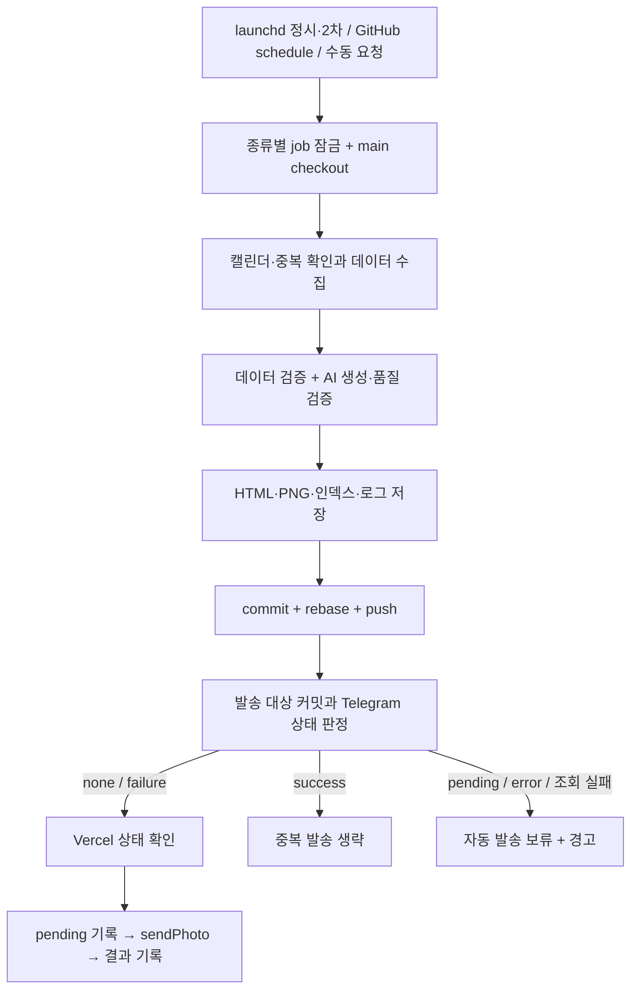

# Dailyreport 파이프라인 진단과 개선 계획

2026년 10월 16일 KST 기준. 프로젝트 운영자와 후속 구현 담당자를 위한 분석이다.

> 후속 검토: 최근 5일 Market·ETF 10편의 실제 발행 내용과 원천 자료를 대조했다. [발행물 품질 평가와 재정렬한 개선 계획](./content-review.md)이 이 문서의 구현 순서에 우선한다. 기존 F01~F14의 관측 근거는 그대로 유지한다. F02의 사실 검증 부재는 실제 발행 오류로 확인됐으며, F09의 데이터 식별·시점 문제와 출처 보존은 첫 배치로 올렸다. P1 안에서는 사실·상품 구조·시간/기간 검증(A), 전략·인과·관찰 조건(B), 출처 추적과 발행·복구(C, 병행) 순으로 진행한다.

현재 일일 운영은 작동하고 있다. 오늘 Market·ETF 모두 Telegram 성공 응답과 Vercel 성공 상태를 확인했고, Market 중복 실행은 발송을 생략했다. 그러나 데이터 검증, 생성 완료 판정, 배포 확인, 장애 감시의 경계에 결함이 있다. 기존 테스트가 모두 통과해도 이 경로들은 보호되지 않는다. 우선 데이터와 콘텐츠의 신뢰성 및 발행·복구 경계를 보강하고, 이어 자동 검증과 운영 감시를 정비해야 한다.

## 분석 범위와 검증 결과

- 코드 기준: 로컬 `e5f8ef0aa4e22e724d968860f10bb0568452ca72`.
- 확인 시 원격 main: `d361aac635fd4d9f0f4c6a019350bd2a2e6bb26f`. 그 사이 두 커밋은 오늘자 리포트·인덱스·로그만 갱신했다. 워크플로 파일의 Git blob도 로컬과 원격이 일치했다. 로컬 작업 트리를 최신화하거나 운영 파일을 덮어쓰지 않았다.
- 검토: Market/ETF 진입점, 수집·검증·AI 호출·렌더·저장, commit/push, Vercel 확인, Telegram 발송 상태, launchd, 한국 매크로 갱신, 웹 리포트 경로, 관련 설계·변경 이력.
- 외부 서비스 호출은 GitHub 조회와 공개 웹 GET으로 제한했다. 워크플로 실행 요청, 배포, 메시지 발송, 유료 AI 호출, 운영 설정 변경은 수행하지 않았다.

| 검사 | 결과 | 해석 |
|---|---|---|
| 기존 테스트 29개 파일 | 242 통과, 0 실패 | 기존 함수·렌더·프롬프트·워크플로 정적 검사 통과 |
| TypeScript | 통과 | `tsc --noEmit --incremental false` |
| ESLint | 실패: 오류 10, 경고 3 | 기존 코드의 require import, any, 내부 링크 및 미사용 코드 |
| Next.js 빌드 | 성공, 경고 1 | ETF 서버 경로의 파일 추적 범위 과다 |
| 장애·경계 재현 | 14개 관측 조건 모두 재현 | 정상 동작을 보장하는 회귀 테스트 통과라는 뜻은 아님 |
| launchd | 설치 plist와 저장소 템플릿 일치 | 두 작업의 마지막 종료 코드 0, 시스템 시간대 Asia/Seoul |
| 셸·plist 구문 | 통과 | `bash -n`, `plutil -lint` |

실행 환경은 Node 25.6.1 / npm 11.17.0이다. 워크플로의 Node 20에서 동일 검사를 실행한 결과는 아니다. README는 Node 24 LTS로 설명하므로 런타임 기준도 정리해야 한다.

재현 코드와 원시 검사 요약은 [reproduce.cjs](./reproduce.cjs), [checks.txt](./checks.txt), 구조화된 운영 근거는 [evidence.json](./evidence.json)에 보관했다. 재현 코드는 실제 TypeScript를 메모리에서 변환해 실행하고 외부 의존성을 대체한다. 파일 쓰기는 별도 임시 디렉터리에서 하고 종료 시 제거한다. A12는 임시 Git 원격/복제본, A14는 실제 워크플로 셸에 로컬 gh/git 대체 명령을 붙여 실행한다. 스크립트의 종료는 감사용 예외로 관측하며, 운영 소스는 수정하지 않는다.

## 실제 운영에서 확인한 것

| 항목 | 관측 |
|---|---|
| 오늘 Market | [run 38811601059](https://github.com/yalkongs/dailyreport/actions/runs/38811601059), 06:47:44 KST Telegram `ok:true`, 커밋 `d17fa69`의 `telegram/market=success` |
| 오늘 Market 중복 | [run 38811607353](https://github.com/yalkongs/dailyreport/actions/runs/38811607353), 기존 파일 확인 후 `status=success action=skip` |
| 오늘 ETF | [run 38822440581](https://github.com/yalkongs/dailyreport/actions/runs/38822440581), 08:19:21 KST Telegram `ok:true`, 커밋 `d361aac`의 `telegram/etf=success` |
| 오늘 KRX | 응답 `BAS_DD=20261015`, 기대값 일치, `prev-session`, 시세 수집 로그 `100/100` |
| 오늘 웹 자산 | 두 본문 HTTP 200 / `text/html`, 두 프리뷰 HTTP 200 / `image/png` |
| 최근 30회 workflow | 모두 `success`; 생성·발송·중복 생략을 합친 실행 표본이며 도착률 100%를 뜻하지 않음 |
| 최근 5회 schedule | 10/12 10:28:28, 10/13 12:05:33, 10/14 10:17:55, 10/15 09:39:59, 10/16 09:31:23 KST 시작 |
| 중복 요청 | 표본의 5개 평일 모두 06:40에 dispatch 두 건. 해당 호스트의 trigger.log에는 매일 06:40 성공 한 건씩 있음. 추가 호출의 출처는 미확인 |

따라서 launchd 정시·2차 트리거와 발송 상태 기반 중복 방어는 유지할 가치가 있다. 독립 GitHub schedule은 이 표본에서 모두 개장 후에 시작했으므로 개장 전 복구 보장으로 계산할 수 없다. Telegram 성공 응답은 확인했지만 구독자 채널을 직접 열어 메시지 표시를 확인한 것은 아니다.

## 핵심 파이프라인과 장애 복구 경로

Market는 시세 수집 뒤에 중복·휴장 검사를 한다. ETF는 수집 전에 검사한다. Market는 최대 3회 생성·정합성 재시도를 하고, ETF는 최대 2회 품질 검증을 시도한 다음 추가 API 호출 결과에서 narrativeNotes를 제거해 검증한다. 저장 순서도 다르다. Market는 HTML→인덱스→PNG이고 PNG 오류를 무시한다. ETF는 HTML→PNG→인덱스이며 PNG 오류는 실패로 끝난다.

| 장애 지점 | 현재 경로 | 남은 문제 |
|---|---|---|
| dispatch 실패 | 로컬 3회 시도, 정시와 2차 trigger | trigger 자체가 모두 안 돌면 실패 이메일도 발생하지 않음 |
| 수집·생성 실패 | 비정상 종료, 다음 trigger가 새 runner로 재시도 | ETF 수집 누락을 성공률 계산에서 잃음; 로컬 Market 재시도는 해시에 막힐 수 있음 |
| 프리뷰 실패 | ETF는 종료, Market는 계속 | Market 불완전 결과가 커밋되고 이후 중복 가드로 고착 가능 |
| push 실패 | job 실패, 다음 trigger에서 다시 생성 | 종류별 잠금은 공유 main의 동시 push를 보호하지 않음 |
| Vercel 실패 | 발송 중단, 후속 실행이 발송 기록을 조회 | 재실행의 배포 확인 SHA 불일치, API 오류 시 루프 즉시 종료 |
| Telegram `ok:false` | failure 기록, 다음 실행 자동 재발송 | 프리뷰 누락 같은 영구 원인은 같은 URL 재발송으로 해결되지 않음 |
| Telegram 응답 유실 | error 기록, 자동 재발송 보류 | 중복 방지에 타당하지만 운영자 도착 감시가 필요 |
| 발송 전 pending 기록 실패 | 보내지 않고 종료 | 안전한 방어. 유지 |
| 실제 발송 후 결과 기록 실패 | pending 유지, 비정상 종료 | 채널 확인 후 수동 재발송이라는 운영 절차가 필요 |
| 상태 조회 실패·기존 pending/error | unknown + warning, CLI exit 0 | 녹색 workflow가 미발송·불명을 가릴 수 있음 |

## 확인된 문제와 우선순위

P0는 즉시 중단·롤백이 필요한 확인된 진행 중 사고, P1은 다음 신뢰성 개선 배치에서 우선 해결할 문제, P2는 그다음 배치, P3는 정리·확장 작업으로 사용한다. 이번 검사에서 진행 중인 P0 사고는 확인하지 않았다. 아래 재현은 발생 가능한 조건을 입증한 것이며 과거 운영에서 동일 사고가 발생했다는 증거와 구분한다.

### F01 P1 ETF 수집 실패율의 분모가 잘못되어 있다

근거: [etf-data.ts:156](/Users/yalkongs/Project/dailyreport/lib/etf/etf-data.ts:156), [pipeline-utils.ts:30](/Users/yalkongs/Project/dailyreport/lib/etf/pipeline-utils.ts:30). Yahoo 오류 종목은 결과 배열에서 제거된다. validateData는 남은 배열의 null 가격만 센다. 전체 100개 중 99개 요청이 실패해도 남은 1개를 `1/1` 성공으로 판단한다. `NaN`, 음수 가격도 통과한다.

재현 A04: 1종만 전달해도 통과; NaN·음수 각각 통과. 현재 실제 100/100 로그와 별개의 장애 조건이다.

개선: 유니버스 전체에 대해 요청·성공·실패를 보존하고, KR/US 및 핵심 종목별 최소 커버리지를 검증한다. 유효 가격은 유한수·양수로 검사한다. 상장폐지·신규 종목은 별도 상태로 관리한다. 완료 기준은 99종 누락, KR 전량 누락, 비정상 가격이 정상 발행 상태로 넘어가지 않는 것이다.

### F02 P1 AI 콘텐츠의 사실·정합성 검증이 발행을 보장하지 못한다

근거: [Market claude-client.ts:567](/Users/yalkongs/Project/dailyreport/lib/claude-client.ts:567), [ETF report-quality.ts:327](/Users/yalkongs/Project/dailyreport/lib/etf/report-quality.ts:327). Market는 마지막 재시도에서 hard violation이 남아도 콘텐츠를 반환한다. ETF 검증기는 문체·금지 표현·일부 정합성을 검사하지만 수익률 등의 숫자가 원천 데이터와 일치하는지 확인하지 않는다. 두 생성기 모두 JSON.parse 후 타입 단언에 의존해 런타임 스키마 검증도 부족하다.

재현 A08: 창 밖 날짜를 3회 반환시켜도 렌더 결과를 성공 반환. A13: 입력 SOXX +1%에 출력 +99.99%를 넣었는데 검증 통과.

개선: 문체 경고와 발행 차단 오류를 분리하고, 데이터·날짜·구조 오류는 재시도 소진 후에도 통과시키지 않는다. 주요 수치를 fact ID가 있는 구조화된 값으로 제공해 코드에서 렌더하고, 자유 산문의 주요 수치 인용은 출처·단위·기준일과 대조한다. 단순 숫자 문자열 전수 비교는 서로 다른 지표·날짜를 혼동하므로 피한다. 런타임 스키마를 정규화 이전에 검증한다. 완료 기준은 잘못된 날짜·누락 필드·잘못된 핵심 수치가 발행되지 않고 검증된 축소판 또는 명시적 실패로 끝나는 것이다.

### F03 P1 Market의 불완전한 결과가 생성 완료로 고착된다

근거: [run.ts:164](/Users/yalkongs/Project/dailyreport/scripts/run.ts:164), [run.ts:322](/Users/yalkongs/Project/dailyreport/scripts/run.ts:322), [run.ts:328](/Users/yalkongs/Project/dailyreport/scripts/run.ts:328), [workflow:157](/Users/yalkongs/Project/dailyreport/.github/workflows/daily-report.yml:157). PNG 오류를 무시한 뒤 HTML·인덱스를 정상 결과로 남긴다. 중복 가드는 PNG를 검사하지 않는다. 주석과 달리 Vercel 성공 상태 확인은 PNG 파일 존재를 검증하지 않는다.

재현 A01: PNG 생성 오류→exit 0→HTML·인덱스 있음/PNG 없음→다음 실행도 exit 0, PNG 재시도 없음. 이 결과가 성공 job에서 커밋되면 새 runner에서도 불완전 상태를 이어받는다. Telegram이 사진 URL을 거부해도 후속 재발송은 같은 누락 URL을 쓰게 된다.

개선: HTML·PNG·메타데이터·입력 해시를 하나의 검증된 발행 묶음으로 준비하고, 모든 자산이 완성된 후 인덱스를 공개한다. 기존 HTML에서 PNG만 복구할 수 있는 경로를 만든다. 발송 전 본문과 PNG의 HTTP 상태·콘텐츠 유형·해시를 확인한다. 완료 기준은 프리뷰 실패를 완료로 기록하지 않고 재실행이 AI 재호출 없이 자산을 복구하는 것이다.

### F04 P1 배포 확인의 커밋과 재시도 처리가 불일치한다

근거: [delivery-state CLI:94](/Users/yalkongs/Project/dailyreport/scripts/delivery-state.ts:94), [workflow:167](/Users/yalkongs/Project/dailyreport/.github/workflows/daily-report.yml:167), [workflow:368](/Users/yalkongs/Project/dailyreport/.github/workflows/daily-report.yml:368). 재발송 대상은 해당 리포트 커밋을 찾지만 배포 폴링은 checkout HEAD를 다시 사용한다. 그 사이 다른 리포트나 코드 커밋이 들어오면 다른 배포를 기다린다. 또 `STATE=$(gh api ...)`는 bash의 오류 즉시 종료 설정에서 첫 API 실패로 끝나므로 주석의 재시도를 실행하지 못한다.

재현 A09: 발송 SHA는 report-sha, 두 폴링 블록은 HEAD에서 별도 결정. A14: 실제 셸에 gh 503을 주입하면 한 번만 호출하고 exit 1. A09는 SHA 불일치를 입증하며 잘못된 콘텐츠가 실제 발송되었음을 뜻하지 않는다.

개선: 리포트 버전→발행 커밋→그 버전을 포함한 production 배포→실제 URL 자산의 연결을 명시한다. 단순히 예전 리포트 SHA만 검사하면 이후 production이 다른 커밋으로 바뀐 경우를 놓치므로 버전·자산 검증도 함께 한다. API 호출 오류는 명시적으로 잡아 상태 실패와 구분해 제한적으로 재시도한다. 완료 기준은 HEAD가 달라지는 복구와 일시 API 오류에서 올바른 버전을 확인한 후 발송하는 것이다.

### F05 P1 종류별 잠금으로 공유 저장소 발행 충돌을 막을 수 없다

근거: [workflow:62](/Users/yalkongs/Project/dailyreport/.github/workflows/daily-report.yml:62), [workflow:133](/Users/yalkongs/Project/dailyreport/.github/workflows/daily-report.yml:133), [workflow:267](/Users/yalkongs/Project/dailyreport/.github/workflows/daily-report.yml:267), [workflow:333](/Users/yalkongs/Project/dailyreport/.github/workflows/daily-report.yml:333). Market·ETF는 다른 concurrency 그룹이지만 모두 main에 쓴다. 한 실행 안의 needs 관계는 별도 dispatch 사이의 동시 실행을 막지 못한다. rebase 오류도 `|| true`로 무시하며 push 재시도는 없다. 주간 매크로 갱신도 같은 저장소에 독립 push한다.

재현 A12: 두 종류가 각각 commit/pull을 마친 후 차례로 push하면 두 번째가 거부된다. 실제 장애 발생 빈도는 이번 표본에서 측정하지 않았다.

개선: 수집·생성과 공유 발행을 분리하고, main 변경을 수행하는 발행 단계는 공통 큐/잠금으로 직렬화한다. 전환 초기에는 rebase 실패를 무시하지 않고 충돌 종류를 분류하며, non-fast-forward만 제한적으로 재시도한다. 완료 기준은 Market·ETF·주간 갱신 동시 시나리오에서 결과 유실·중복 발송 없이 끝나는 것이다.

### F06 P1 미발송·결과 불명을 독립적으로 발견하는 감시가 없다

근거: [delivery-state CLI:107](/Users/yalkongs/Project/dailyreport/scripts/delivery-state.ts:107), [run-etf.ts:273](/Users/yalkongs/Project/dailyreport/scripts/run-etf.ts:273), 두 workflow와 launchd 구성. 상태 불명은 경고 후 exit 0이고, 운영 알림 설계는 비정상 종료에 대한 GitHub 이메일을 중심으로 한다. 실행 요청 자체가 빠지면 job 실패가 생기지 않는다. 불명 상태에서 자동 발송을 멈추는 정책 자체는 중복 방어에 타당하다.

재현 A10: GitHub 조회 오류→action=unknown→exit 0. 운영 표본에서는 schedule 백업이 모두 개장 후 시작했다.

개선: 생성·배포·발송·불명·휴장 생략을 별도 결과로 기록한다. 독립 감시가 한국 영업일의 도착 기한을 확인하고 운영자용 경보를 발생시키도록 한다. 구독자 채널과 운영 알림 채널을 분리한다. pending/error는 경과 시간·담당자·채널 확인 절차를 갖춰 수동 해소하며 TTL 만료만으로 자동 재발송하지 않는다. 완료 기준은 dispatch 누락과 녹색 unknown을 모두 감지하면서 정상 휴장에는 경보를 내지 않는 것이다.

### F07 P2 fallback과 타임아웃을 전체 실행 예산에 맞춰 설계해야 한다

근거: [run-etf.ts:204](/Users/yalkongs/Project/dailyreport/scripts/run-etf.ts:204), [ETF claude-client.ts:88](/Users/yalkongs/Project/dailyreport/lib/etf/claude-client.ts:88), [fetcher.ts:4](/Users/yalkongs/Project/dailyreport/lib/etf/fetcher.ts:4). Tier 1은 세 번째 API 호출 결과에서 narrativeNotes를 제거하는 방식이다. AI 서비스 장애의 대체 경로는 아니다. SDK 생성자에 시간·재시도 예산이 명시되어 있지 않으며, 설치된 SDK는 기본 timeout 10분/maxRetries 2를 가진다. job 전체 상한은 Market 20분, ETF 15분이며 폰트 설치 최대 5분과 배포 폴링 약 10분도 같은 예산을 쓴다. ETF fetch helper는 헤더 수신 뒤 타이머를 해제해 JSON/text 본문 읽기를 제한하지 못한다.

재현 A07: 두 호출 실패 후 fallback도 같은 API 호출→실패. A11: 제한 10ms, 본문 60ms 지연인데 정상 반환하고 abort되지 않음.

개선: API 가용성 오류·JSON 구조 오류·품질 오류를 구분한다. 품질 문제라면 이미 확보한 후보를 재검증해 활용하고, 가용성 장애라면 검증된 수치만 담는 결정론적 축소판을 제공한다. 호출·본문 읽기·재시도·배포 대기의 단계별 상한과 전체 deadline을 정한다. 완료 기준은 모델 장애가 예산을 전부 소진하기 전에 축소판 또는 운영 경보로 끝나는 것이다.

### F08 P2 Market 강제 재생성과 로컬 재시도가 가격 해시에 막힌다

근거: [run.ts:165](/Users/yalkongs/Project/dailyreport/scripts/run.ts:165), [run.ts:234](/Users/yalkongs/Project/dailyreport/scripts/run.ts:234). FORCE_REGENERATE는 파일 중복 가드만 우회한다. 가격 해시 가드는 그대로 적용하고, 해시는 생성 성공 전에 저장한다.

재현 A02: 기존 결과+동일 가격+FORCE_REGENERATE→AI 생성 생략. A03: 같은 작업 디렉터리에서 생성 실패 후 재시도→리포트 없이 exit 0. A03은 실패 job의 작업물을 커밋하지 않는 새 Actions runner에서는 그대로 지속되지 않으므로 로컬·재사용 runner 문제로 한정한다.

개선: 강제 재생성의 우회 범위를 일관되게 정의하고 해시는 완료된 발행 묶음에만 기록한다. 가격 동일성을 휴장 판정과 혼동하지 말고 캘린더·기준 세션·데이터 신선도로 판단한다. 완료 기준은 동일 가격에서도 명시적 강제 생성과 실패 후 재시도가 동작하는 것이다.

### F09 P2 데이터 소스 장애가 가려지고 KRX가 독립 복구 소스로 작동하지 못한다

근거: [etf-data.ts:261](/Users/yalkongs/Project/dailyreport/lib/etf/etf-data.ts:261), [market-context.ts:20](/Users/yalkongs/Project/dailyreport/lib/etf/market-context.ts:20), [run-etf.ts:118](/Users/yalkongs/Project/dailyreport/scripts/run-etf.ts:118). KRX 병합은 Yahoo에 존재하는 종목만 순회한다. 정상 KRX 결과가 있어도 Yahoo에서 탈락한 국내 종목을 복구하지 않는다. 거시 수집기는 오류를 null로 바꾸고 fulfilled를 반환해 바깥의 rejection 기반 failedSources가 전체 실패를 놓친다. 일반 Market/Yahoo 시세는 실제 시세 기준시각을 보존하지 않고 수집 시각만 남긴다.

재현 A05: 정상 KRX 전일 행+Yahoo 실패→quotes 0개. A06: 거시 전체 장애→모든 값 null인 fulfilled 반환.

개선: 데이터 소스별 결과에 값·기준일·수집시각·오류·품질 상태를 함께 보존한다. 유니버스 기준으로 KRX/Yahoo 병합 우선순위와 서로 다른 세션의 혼합 금지를 적용한다. KR/US 시세는 해당 시장 세션, 환율·선물·가상자산은 별도 신선도 기준으로 판단한다. 완료 기준은 Yahoo 장애 시 유효 KRX 국내 데이터가 살아 있고, 거시 전량 null이 정상 소스로 표시되지 않는 것이다.

### F10 P2 이상 탐지 5종 설명과 실제 입력 경로가 다르다

근거: [analyzer.ts:4](/Users/yalkongs/Project/dailyreport/lib/etf/analyzer.ts:4), [etf-data.ts:153](/Users/yalkongs/Project/dailyreport/lib/etf/etf-data.ts:153), [etf-data.ts:211](/Users/yalkongs/Project/dailyreport/lib/etf/etf-data.ts:211). AUM 변화는 TODO이고, 수집한 trackingError는 항상 null이며, consecutiveForeignSell은 항상 0이다. analyzer에는 연속 매도를 이력에서 계산하는 코드가 없다. 따라서 현재 수집 경로에서 활성인 검사는 괴리율·거래량이다. 로컬 최근 30개 evidence 엔트리의 anomalyBreakdown도 괴리율 또는 빈 객체만 보였다. 이는 나머지 지표가 정상이라는 의미가 아니다.

개선: 지표별 supported/unavailable 상태를 공개하고 실제 미측정과 정상 0을 구분한다. 추적오차·연속매도·AUM 변화는 신뢰할 이력 확보 뒤 활성화한다. 완료 기준은 운영 설명과 실제 측정 범위가 일치하고, 각 활성 룰에 값이 공급되는 통합 검사가 있는 것이다.

### F11 P2 테스트가 운영 변경을 막는 자동 검증으로 연결되지 않았다

근거: [package.json](/Users/yalkongs/Project/dailyreport/package.json), `.github/workflows/`의 두 파일, [workflow-triggers.test.ts](/Users/yalkongs/Project/dailyreport/lib/workflow-triggers.test.ts). npm test/typecheck 명령과 PR/push 검증 workflow가 없다. 242개 테스트가 있지만 워크플로 검사는 주로 문자열 존재를 확인해 실행 중 셸 오류나 상태 전이를 검증하지 않는다. lint는 현재 실패한다. Node 기준은 로컬 25/Actions 20/README 24로 다르다.

개선: 하나의 지원 Node LTS와 npm/lockfile 기준을 고정하고, lint 오류를 정리한 뒤 PR에 test·typecheck·lint·build를 연결한다. 생성·발송 workflow와 검증 workflow를 분리해 테스트가 자격증명이나 외부 발송에 의존하지 않게 한다. actionlint 등 워크플로 검사와 실제 셸/임시 Git/가짜 API 기반 복구 검사를 추가한다. 완료 기준은 CI가 회귀를 실패시키며 정상 변경은 한 명령으로 검증되는 것이다.

### F12 P2 트리거 관리와 연간 캘린더 갱신을 운영 작업으로 관리해야 한다

근거: 위 최근 실행 표본, [dispatch.sh:18](/Users/yalkongs/Project/dailyreport/ops/macmini/dispatch.sh:18), [market-calendar.ts:49](/Users/yalkongs/Project/dailyreport/lib/market-calendar.ts:49). 06:40 이중 요청의 추가 주체가 정리되지 않았다. 정시/2차는 같은 호스트의 전원·로그인·인증에 의존하며, GitHub schedule은 지연 표본상 개장 전 보장이 없다. KR/US 휴일 테이블은 2026만 포함한다. 새해 미커버 시 명시적으로 중단하는 가드는 바람직하지만 사전 갱신 담당·기한·경보가 필요하다.

개선: 트리거별 소유자·실행 주체·토큰·시간대·대체 경로를 목록화하고 추가 호출 출처를 확인한다. 제거는 주체와 복구 역할을 확인한 뒤 한다. 2027 캘린더는 공식 공고 확인과 함께 추가하고, 연말까지의 커버리지 사전 검사 및 갱신 책임자를 둔다. 완료 기준은 트리거가 설명 가능한 수로 수렴하고, 다음 연도 미커버가 연초 장애 전에 검출되는 것이다.

### F13 P2 웹 상태 확인과 배포 파일 범위를 명확히 해야 한다

근거: [Market page.tsx:100](/Users/yalkongs/Project/dailyreport/src/app/reports/[date]/page.tsx:100), [brand-logo.ts:34](/Users/yalkongs/Project/dailyreport/lib/preview/brand-logo.ts:34), 빌드 출력. 없는 Market 리포트도 일반 컴포넌트로 반환해 HTTP 200이다. 실제 `reports/2099-01-01`은 200, ETF 동일 날짜는 404였다. HTTP 200만으로 도착 여부를 판단하면 오탐한다. 빌드는 ETF 경로 NFT에 839개 파일을 포함했고, 관련 없는 설계 문서와 양쪽 전체 리포트 자산도 추적했다. 이 검사에서 비밀 파일 유출을 확인한 것은 아니다.

개선: 없는 리포트는 일관된 404, 있는 리포트는 종류·날짜·버전을 검증할 수 있는 메타데이터를 제공한다. 로고 읽기 경로를 정적으로 제한하고 실제 필요한 런타임 파일만 추적하도록 한다. 완료 기준은 가짜 날짜가 건강한 리포트로 판정되지 않고 불필요한 서버 번들 추적이 사라지는 것이다.

### F14 P3 문서·백필·아카이브 관리 기준을 정리해야 한다

근거: [README:253](/Users/yalkongs/Project/dailyreport/README.md:253), [Market market-data.ts:195](/Users/yalkongs/Project/dailyreport/lib/market-data.ts:195), [run-etf.ts:43](/Users/yalkongs/Project/dailyreport/scripts/run-etf.ts:43). README는 REPORT_DATE 백필을 설명하지만 Market 실제 날짜 override는 TEST_DATE다. ETF 날짜 override는 현재 시세에 과거 라벨을 붙이는 동작으로 주석에 명시되어 있으며, 과거 데이터 재현과 다르다. README의 최종 갱신일·토큰 상한·운영 통계·이상 탐지 설명에 과거 내용이 섞여 있다.

로컬 인덱스 기준 Market 135개/ETF 124개 날짜 중 HTML 누락·중복 날짜는 없었다. Market 초기 8개 날짜에 PNG가 없다: 2026-04-01, 02, 03, 06, 07, 08, 09, 10. 이 오래된 누락을 F03의 실행 사고로 단정할 근거는 없다. ETF는 PNG 누락이 없다.

개선: 현재 운영 규약과 역사적 설계를 구분하고, 백필은 저장된 입력 snapshot을 사용하는 재생성과 현재 데이터를 과거 날짜에 출력하는 실험을 분리한다. 오래된 PNG는 기존 HTML에서 복원 가능한지 확인하고 호환 정책을 정한다. 완료 기준은 README 명령이 실제 계약과 일치하고 과거 리포트 재현이 현재 시세를 오인하게 하지 않는 것이다.

## 단계별 실행 계획과 완료 기준

공수는 저장소 구조를 기준으로 한 추정이며 실제 API 계약·운영자 알림 수단 확인에 따라 달라진다. 아래 단계는 전면 재작성보다 작은 변경과 회귀 검증을 우선한다.

| 단계 | 범위와 결과물 | 예상 개발 공수 | 완료 기준 |
|---|---|---|---|
| 0 검증 기반 | Node·npm 기준, test/typecheck 명령, lint 오류 정리, 발송 없는 CI, 장애 fixture | 0.5~1일 | 현재 242개 테스트·타입·린트·빌드가 CI에서 통과; 이후 PR의 결함을 실패로 검출 |
| 1 데이터·콘텐츠 신뢰성 | F01/F02/F09: 소스 결과 계약, 커버리지·세션·수치 검증, 런타임 스키마, AI 검증 차단 정책 | 2~4일 | 1/100·KR 누락·NaN·날짜 오류·수치 날조를 정상 결과로 발행하지 않음; 정상 수집을 불필요하게 막지 않음 |
| 2 발행·복구 안정성 | F03/F04/F05/F08: 완성 자산 manifest, 자산 복구, 강제 생성, 공유 발행 직렬화, 버전 배포 확인 | 2~3일 | PNG 실패·API 503·HEAD 이동·동시 push 후 재실행이 결과 유실·중복 발송 없이 복구 |
| 3 장애 가시성과 예산 | F06/F07/F12: 독립 도착 감시, 불명 상태 처리, 명시적 시간 예산, API 장애 축소판, 트리거 정리 | 2~3일 | dispatch 누락·unknown·모델 장애 탐지; 자동 재발송의 불명 상태 방어 유지; 전체 deadline 내 결과 확정 |
| 4 정합성과 정리 | F10/F13/F14: 측정 가능 지표 표시, 404·파일 추적, 문서·백필·아카이브, 2027 갱신 | 1~2일+공식 일정 확인 | 기능 설명과 실제 측정 범위 일치; 불필요 추적 제거; 검증 가능한 운영 절차 |

각 단계는 별도 PR로 나누고, 배포 전 해당 결함의 재현 조건을 원하는 동작을 검증하는 회귀 테스트로 전환한다. 이 문서의 reproduce.cjs는 현 결함을 관측하는 감사 도구이므로 정상 회귀 테스트에 그대로 편입하면 안 된다. 결함 수정 후 해당 관측 assert가 실패하는 것이 자연스럽다.

## 목표 코드와 운영 구조

1. **수집 결과 계약**: source·symbol·value·unit·asOf·collectedAt·status·error를 보존한다. 전체 유니버스와 핵심 종목의 커버리지를 계산하고 누락을 값 0과 구분한다.
2. **검증된 입력 snapshot**: 생성에 사용한 정규화 데이터·뉴스·캘린더·설정 버전과 입력 해시를 저장한다. 재현·비용 집계·원인 분석의 기준으로 쓴다.
3. **발행 묶음**: 리포트 종류·발행일·버전·입력 해시·품질 결과·HTML/PNG 해시를 manifest로 관리한다. 임시 경로에 준비하고 전체 검증 후 공개한다. 인덱스는 완성된 묶음만 가리킨다.
4. **공유 발행 경계**: 생성은 종류별로 독립 실행하되 main 갱신은 하나의 작성 경로에서 처리한다. commit status는 현재 발송 호환 수단으로 유지하면서 manifest 버전과 연결한다. 저장소/호스팅 전면 교체는 이번 결함 해결의 전제 조건이 아니다.
5. **단계별 상태**: 수집·검증·생성·발행·배포·전송은 별도 상태를 가진다. 휴장 생략, 이미 발송, 명시적 실패, 결과 불명을 구분한다. Telegram message_id도 성공 근거에 보존한다. pending/error만 보고 자동으로 중복 발송하지 않는다.
6. **운영 감시**: 독립 감시가 본문 날짜·버전, PNG, 배포, 전송 상태를 대조한다. 제안 도착 목표는 Market 07:00, ETF 08:30 KST이며, 경보 검사 시각은 각각 07:05/08:35로 시작해 운영자와 확정한다. 이는 현재 보장된 SLA가 아니다.

관측 지표는 영업일별 제시간 도착률, 단계별 소요 시간, 소스 커버리지·신선도, 검증 실패 사유, 생성 재시도·토큰 비용, 축소판 비율, 발송 불명 체류 시간이다. workflow success 비율 하나로 대체하지 않는다.

## 검증과 전환 절차

- 외부 자격증명이 없는 테스트에서 정상 영업일·KR/US 휴일·주말·연말, 1/100·KR 전량 누락·거시 전량 실패, 모델 타임아웃·잘못된 JSON·잘못된 날짜·수치, PNG 실패·인덱스 손상, 동시 push·배포 지연·HEAD 이동·GitHub 503, Telegram 거부·응답 유실·상태 기록 실패를 검증한다.
- 수정 전후 같은 snapshot으로 HTML·핵심 수치·링크·PNG·manifest를 대조한다. Telegram 성공/실패는 가짜 API로 검증하고 시험용 환경에서 별도로 확인한다. 실구독자 대상 재발송을 테스트 수단으로 쓰지 않는다.
- 배포 전 새 경로를 발송 없이 병행 생성해 기존 결과와 대조한다. 통과 후 Market 또는 ETF 한 종류부터 전환하고 최소 5개 한국 영업일 관측한 뒤 확장한다.
- 롤백은 마지막 검증된 코드·설정으로 되돌리되, 이미 발송한 리포트의 전송 기록은 보존한다. 공개 리포트와 상태를 삭제해 재발송을 유도하지 않는다. 새 상태 계약은 전환 기간에 기존 commit status와 호환되게 한다.

## 후속 검증의 한계와 남은 확인

이번 결과는 실제 코드 실행·로컬 검사·오늘 운영 로그에 근거하지만, 전체 과거 리포트의 금융 수치·뉴스 사실관계·시각 품질을 전수 검증한 것은 아니다. GitHub Actions 스케줄러나 Vercel production을 장애 상태로 변경하지 않았다. 잠재 충돌·장애의 운영 발생률은 별도 계측이 필요하다.

다음 구현 시 확인할 항목은 추가 06:40 호출 주체, 독립 감시의 실행 위치·운영자 수신 경로, 지원 Node 버전, 데이터 소스별 시간·단위 계약, 2027 공식 휴장 일정이다. API 이용약관·법률 고지 적정성은 이번 코드·복구 분석과 별도의 검토 범위다.

핵심 운영 학습은 세 가지다. 현재 중복 방어는 보존할 가치가 있고, 결과 불명은 중복 방지 정책과 운영 경보를 함께 갖춰야 하며, 입력·자산·배포·발송이 같은 리포트 버전을 가리킨다는 증거가 완료 판정의 기준이 되어야 한다.
